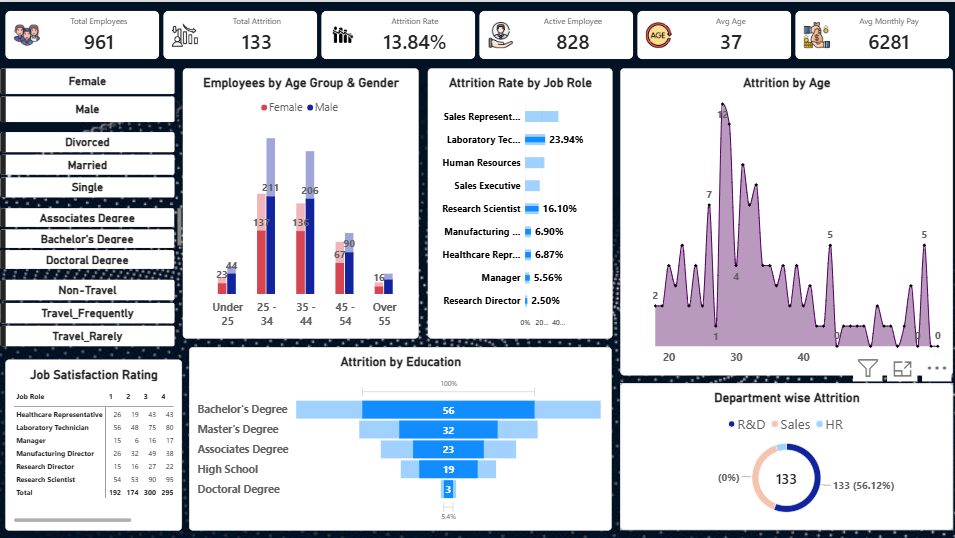

# HR Analytics Dashboard

An interactive Power BI dashboard that analyzes employee attrition and workforce demographics, helping HR teams understand who is leaving and which factors are linked to it.

## Dashboard Preview



## Key Metrics

| Metric | Value |
|---|---|
| Total Employees | 961 |
| Total Attrition | 133 |
| Attrition Rate | 13.84% |
| Active Employees | 828 |
| Average Age | 37 |
| Average Monthly Pay | 6,281 |

## Features

- Attrition analysis by age, job role, education level and department
- Employee distribution by age group and gender
- Job satisfaction ratings by job role
- Interactive slicers for gender, marital status, education and business travel
- KPI cards for headcount, attrition, attrition rate, active employees, average age and average monthly pay

## Key Insights

- Laboratory Technicians show one of the highest attrition rates (23.94%), while Research Directors show the lowest (2.50%)
- Employees with a Bachelor's degree account for the largest share of attrition (56 of 133)
- Attrition peaks among employees in their late 20s and early 30s
- Most employees fall in the 25-44 age range, with more males than females in every age group

## Tools Used

- Power BI Desktop
- DAX
- Power Query
- Microsoft Excel (data source)

## Repository Structure

```
hr-analytics-dashboard/
├── README.md
├── dashboard.png
├── HR_Dashboard.pbix
├── HR_Dashboard.pbit
├── data/
│   └── company-data.xlsx
└── images/
    └── KPI card icons
```

- `HR_Dashboard.pbix`: Power BI report file
- `HR_Dashboard.pbit`: Power BI template (no data; connect your own)
- `dashboard.png`: dashboard screenshot
- `data/`: dataset used in the report
- `images/`: icons used in the KPI cards

## How to Use

1. Download `HR_Dashboard.pbix` and open it in Power BI Desktop.
2. To use your own data, open `HR_Dashboard.pbit`, enter your data source details when prompted, and click Load.
3. Use the slicers on the left to filter by gender, marital status, education and business travel.

## Dataset

The dataset is a sample HR dataset with employee attributes such as age, gender, education, job role, department, business travel, monthly income, job satisfaction and attrition status.

Source: add your dataset link here (for example, the Kaggle link).

## Author

**Aryan Bhardwaj**
GitHub: [aryanbhardwaj-tech](https://github.com/aryanbhardwaj-tech)
